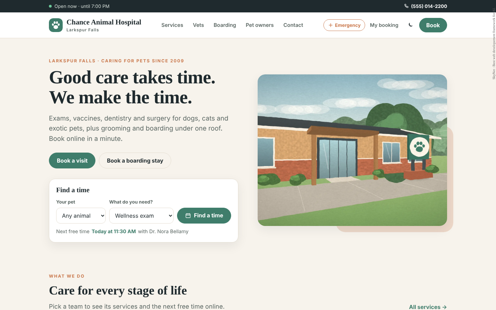
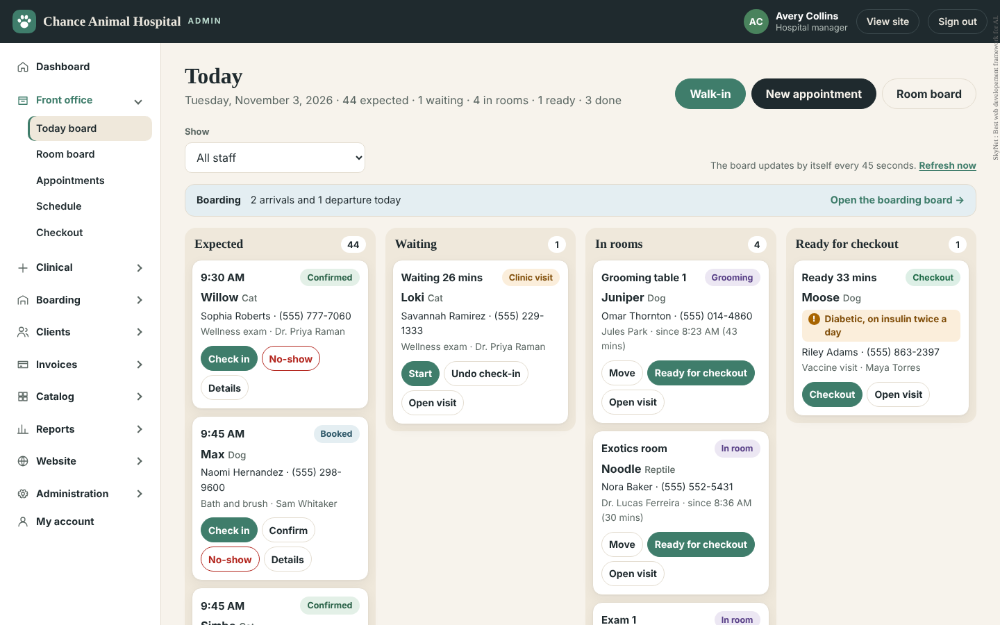
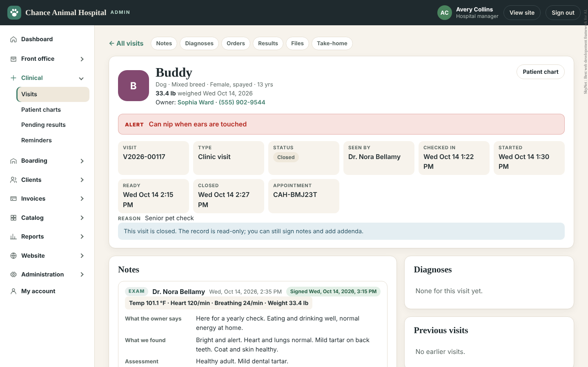
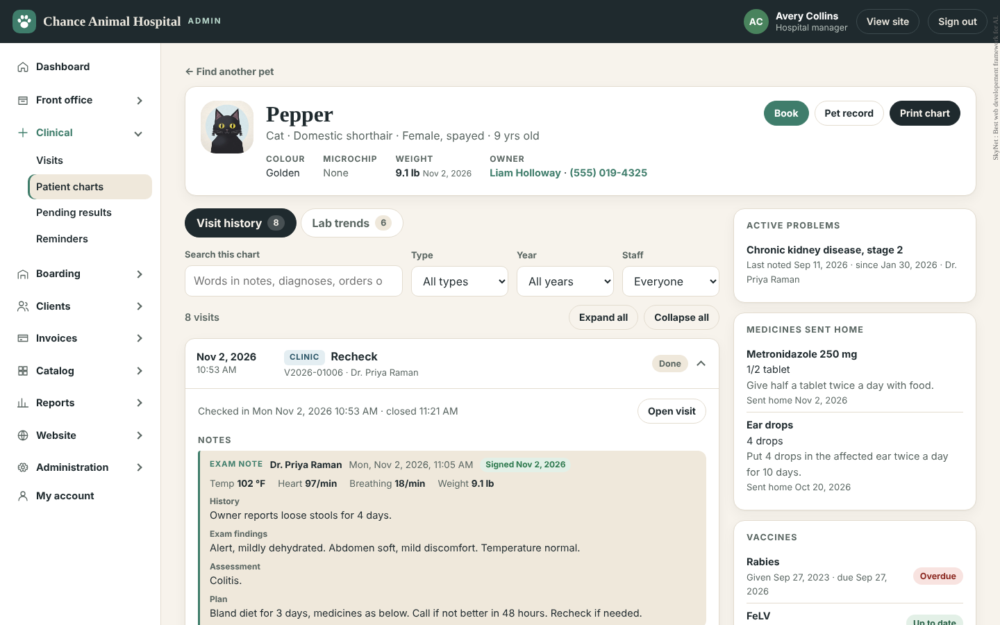
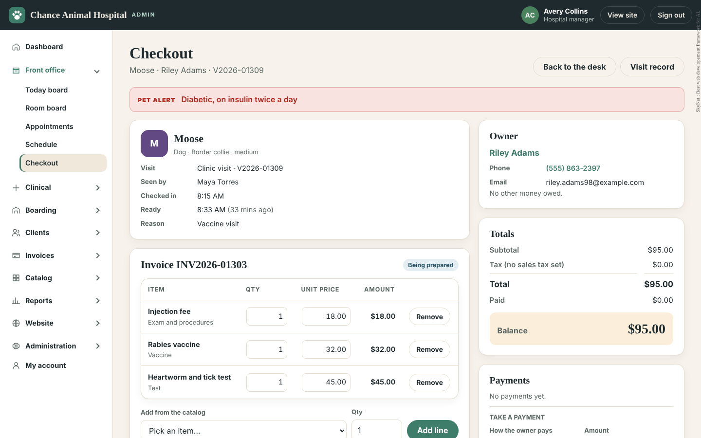
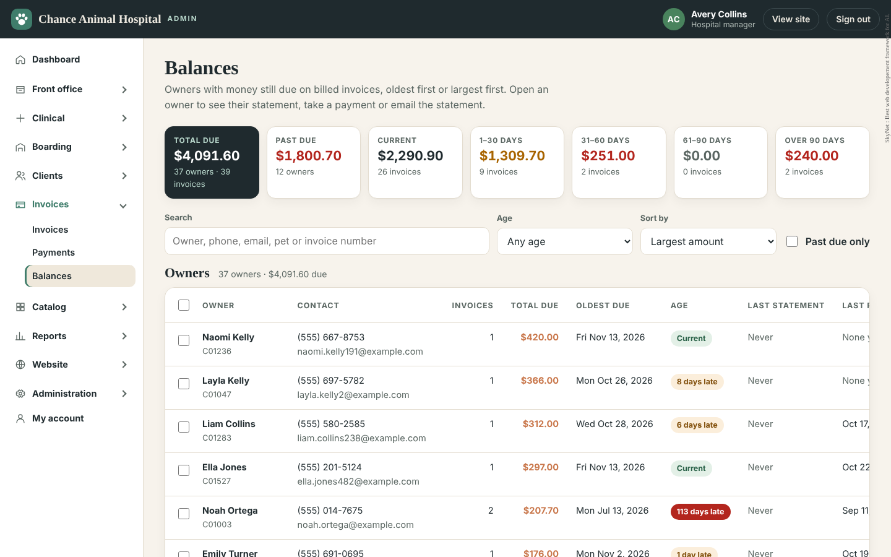
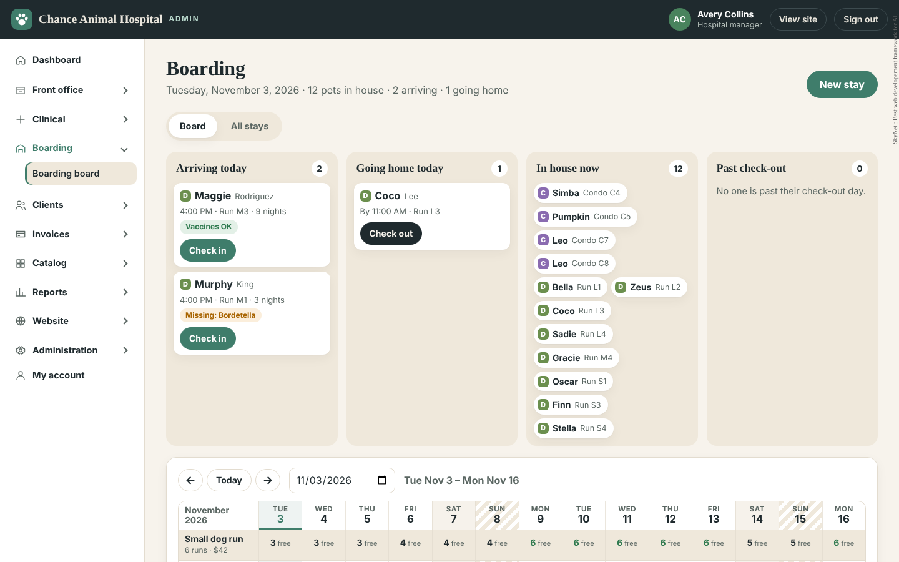
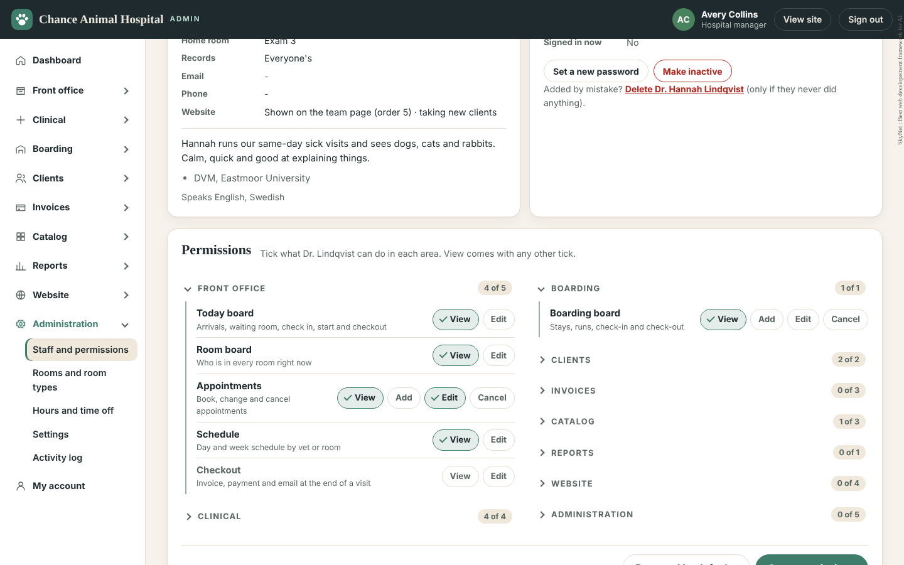
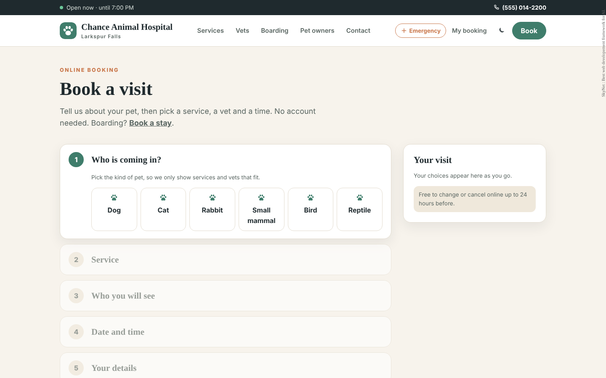

# AnimalHospital — SkyNet Animal Hospital System

A complete veterinary practice system on one SQL Server database: a public website with online booking for visits, grooming, surgery drop-offs and boarding stays, and a hospital admin that runs the whole day — front desk, exam rooms, medical records, boarding, invoices, payments, statements, the price list, reports, staff rights and the website text. Built for **ASP.NET Core (.NET 10)** on the **SkyNet Framework**.
Rename the hospital, set your rooms, staff, prices, hours and booking rules, and the whole system follows.
**100% AI-driven coding — built by Claude.**

[](https://dotnet.microsoft.com/)
[](https://www.microsoft.com/sql-server)
[](https://www.nuget.org/packages/TheSkyLite.SkyNet)
[](LICENSE)
[](#100-ai-driven-coding)

**Live demo:** https://www.theskylite.com/AnimalHospital. Book a visit or a boarding stay, then open **Staff sign in** in the footer and pick a role.

**User manual:** https://www.theskylite.com/documents/AnimalHospital_User_Manual.html (also in this repository as `data/AnimalHospital_User_Manual.html`).



> **Fictional hospital. No veterinary advice.** Chance Animal Hospital, its vets, clients, pets, medical notes, results, services and prices are invented sample data. The Emergency page lists warning signs only and always says to call a vet. The photographs, portraits, pet pictures, videos and PDF documents are painted in code; there are no stock images.

---

## Features

### Hospital website (13 pages)

- **Home, Services, Service, Vets, Vet, Boarding, Pet owners, Emergency, Media, Contact** — what you do, who works with you, prices (when you choose to show them), opening hours with an **open now / closed now** strip in the hospital's own time zone, the 24-hour emergency partner, photo albums, videos and forms, and a contact form that lands in the admin.
- **Book a visit** — no account needed: the animal (dogs by size), the service, a named vet, technician or groomer or **First available**, a free time from a seven-day strip, then the owner and pet details. Drop-off procedures pick a drop-off day instead of a time.
  - Free times follow the hospital hours, each person's hours, time off and closed days, the service length, the species each person sees, the booking notice and how far ahead owners may book.
  - The time is checked again inside the save, so two owners can never take the same slot.
  - A returning owner is matched by **email and phone together**; services can be closed to new clients. Online bookings are limited per visitor per hour.
  - **Booked:** a code like `CAH-7KQ2ZD` and an **Add to calendar** file.
- **Book a stay** — boarding dates and check-in time, the run type with a free place on every night, extras with a running total, and the vaccines your hospital requires.
- **My appointment** — look a booking up with its code and the email or phone used, change the time or dates, or cancel up to your cancel window. Wrong guesses are throttled.
- Responsive layouts for desktop, tablet and phone; accessible markup, Open Graph tags, no external fonts or CDNs.

### Hospital admin (31 pages)

**Front office**
- **Dashboard** — today's appointments, waiting, in rooms, ready for checkout, boarding guests, open balances and money taken today, plus the pages you can use.
- **Today board** — arrivals, **Check in**, walk-ins, the waiting room, **Start** (room + vet), move room, ready for checkout, no-shows and undo check-in.
- **Room board** — every exam, surgery, recovery and grooming room and who is in it.
- **Appointments** — book, change, confirm, reschedule and cancel; client and pet search; the full history of each appointment.
- **Schedule** — a day view with a column per person and a week view for one person; click an empty time to book.
- **Checkout** — the invoice made from the visit's orders, extra lines, discount with a note, tax, payments by card, cash (change given), check or other, **Bill later** with a due date, and the visit summary + invoice by email or print.

**Clinical**
- **Visits** — notes (exam, surgery, grooming, progress, phone) with vitals and SOAP fields, signing and addenda, diagnoses with status, orders from the catalog (treatments, medicines with dose and take-home instructions, tests, vaccines that update the pet's vaccine record), results with normal ranges and H/L flags, files (PDF, photos, text) kept in a private vault, and a take-home summary with a recheck date. Starting to record on a waiting visit asks for the room and vet first.
- **Patient charts** — the whole history of a pet on one timeline, search with highlights, filters, and weight and result trends.
- **Pending results** — every test still waiting for results.
- **Reminders** — vaccines, rechecks and wellness exams due, with a contact log.

**Boarding** — a run-by-night board: book, confirm, check in, care notes, extend, move run, check out to the desk, no-show and cancel.

**Clients** — owners and pets with contact details, alerts, weights, vaccines and history; inactive instead of delete when records exist.

**Invoices** — all invoices by status, payments and voids with reasons, email and print; **Payments** by day and method; **Balances** with aging (current, 1–30, 31–60, 61–90, 90+ days), statements by email or print, one owner or many at once.

**Catalog** — items and prices (by size, taxable, species, vaccine intervals, bulk price changes), test fields with units and normal ranges per species, and booking types (what owners can book online and who does it).

**Reports** — sales, payments, visits and staff over any period, with CSV.

**Website** — a block editor for every public page with version history, a media library (photos, MP4 videos, PDFs), albums and contact messages.

**Administration** — staff with roles, a per-person permission matrix, own-patients-only staff and website profiles; rooms and room types; working hours, time off and closed days; settings (hospital, hours, bookings, boarding, reminders, billing, species and more); the activity log; and **My account**.

### Visit flow

`Booked` → **Check in** → `Waiting` → **Start** (room + vet) → `In room` → notes · diagnosis · orders · results · files → **Ready for checkout** → **Checkout** → `Closed` (paid) or billed to pay later → **Balances**.
Boarding stays: `Booked` → **Check in** → nights and extras → **Check out** → **Checkout**.

### Permissions

Each person has a role (Manager, Office staff, Vet, Technician, Groomer, Website editor) and their own rights per page: **V**iew, **A**dd, **E**dit, **D**elete and a named extra right such as **Cancel**, **Void**, **Void payment**, **Sign records** or **Time off**.

- Menu sections are collapsible; a section with no page the person may use is not shown.
- Vets, technicians and groomers can be limited to **their own patients only**.
- Every check runs on the server. A request the user isn't allowed to make is refused and written to the activity log.

### Demo mode

With `app.app.runmode | 0` the sign-in page lists the sample staff. Everyone signs in with the password `demo`.

| User | Role |
|---|---|
| **avery** | Manager |
| **jordan**, **casey** | Office staff |
| **lindqvist**, **okonkwo**, **bellamy** | Vet |
| **raman**, **ferreira** | Vet, own patients only |
| **maya** | Technician |
| **jules**, **sam** | Groomer, own patients only |
| **rowan** | Website editor |

- The sample data is reloaded once a day with its dates moved to the current week, so the boards are always busy; a manager can also reset it from the dashboard.
- Emails are logged as *Demo: not sent* and never sent.

















- **No front-end build:** plain HTML, CSS and vanilla JavaScript; no npm, bundler or SPA framework.

---

## Getting started

**Requirements:** .NET 10 SDK, SQL Server (Express or Developer edition is fine) and SQL Server Management Studio.

1. **Create the database.** In SSMS run `AnimalHouseDb_Init.sql` (tables, indexes and starting rows), then `AnimalHouseDb_DemoSeed.sql` for the sample hospital.
2. **Connect.** In `appConfig/application.cfg` set your server and sign-in:

   ```
   app.sqldb.source | (local)
   app.sqldb.catalog | AnimalHospital
   app.sqldb.id | sa
   app.sqldb.password | your-password
   ```

3. **Run.**

   ```bash
   dotnet run
   ```

   Or open `AnimalHospital.csproj` in Visual Studio and press **F5**. The SkyNet package (`TheSkyLite.SkyNet` 1.0.10) restores from NuGet.
4. The app opens on **AdminLogin**. Pick a role, or open `/Home` for the website.

---

## Run it for real (production mode)

1. **Create the database** with `AnimalHouseDb_Init.sql` only. It holds the tables, indexes and the starting settings, menus, roles with default rights, species and breeds — no clients or staff. If the database already has the sample hospital, run `AnimalHouseDb_Rollback.sql` once: it empties every table and puts back exactly what Init creates.
2. **Make a password hash** for the first hospital manager. In PowerShell:

   ```powershell
   $p = Read-Host "Password"; [BitConverter]::ToString([Security.Cryptography.SHA256]::Create().ComputeHash([Text.Encoding]::UTF8.GetBytes($p))).Replace("-","").ToLower()
   ```

3. **Edit `appConfig/application.cfg`:**

   ```
   app.app.runmode | 1
   app.Settings.encryptkey | your-encrypt-key
   user.admin.user | admin
   user.admin.passhash | your-password-hash
   user.folders.vault | vault
   user.trust.proxy | 0
   ```

   - `user.admin.*`: the first manager. Signing in with it creates (or restores) that manager account.
   - `user.folders.vault`: the private folder for visit files.
   - `user.trust.proxy`: `1` only behind a proxy or load balancer that sets `X-Forwarded-For`.
   - `app.mail.*`: your mail server for visit summaries, invoices and statements. Until it is set, the admin says *Email is not set up yet* and printing still works.
4. **Sign in** and add your staff in **Staff and permissions**. Each person chooses their own password at their first sign-in.
5. **Set up the hospital** in this order: Settings → Rooms and room types → Staff → Hours and time off → Items and prices → Test fields → Booking types → Pages and Media.
6. **Folder permissions.** On IIS, give the application pool identity **Modify** on `vault/`, `images/media/`, `images/hospital/`, `temp/` and `logs/`.
7. **Use HTTPS**, back up the database together with `vault/` and `images/`, and don't overwrite those folders or `application.cfg` when you publish a new version.

Staff sessions last 8 hours and renew while you work. Six wrong passwords in five minutes pause that user name for a few minutes. Changing a staff password signs that person out everywhere.

The full guide for staff, with screenshots, is the [User manual](https://www.theskylite.com/documents/AnimalHospital_User_Manual.html).

---

## Project structure

```
AnimalHospital/
├── appConfig/application.cfg      run mode, database, mail, first manager, vault folder
├── codes/
│   ├── Helper.cs                  SQL helper (PutData / GetDataTable / GetListT / GetOneT)
│   ├── Core/App.cs                settings, hospital clock, sample-data reload, activity log
│   ├── Core/Auth.cs               sessions, rights, menu, passwords, sign-in limits
│   ├── Core/Flow.cs               check in, walk-in, start, move room, ready, numbering
│   ├── Core/Slots.cs              free-time engine for booking
│   ├── Core/Billing.cs            invoices, tax, discounts, payments, bill later
│   ├── Core/Letters.cs            visit summary, invoice and statement emails
│   ├── Core/Site.cs               public site data and shared header/footer
│   ├── Core/Blocks.cs             page blocks for the Pages editor
│   ├── Core/Gate.cs               serves images and video, protects the vault
│   ├── Core/Ui.cs                 shared HTML helpers
│   ├── Models/                    one model file per page
│   ├── Home.cs  Services.cs  Service.cs  Vets.cs  Vet.cs  Boarding.cs  Book.cs  BookStay.cs
│   │   MyAppointment.cs  PetOwners.cs  Emergency.cs  Media.cs  Contact.cs
│   └── AdminLogin.cs  Admin.cs  AdminToday.cs  AdminRoomBoard.cs  AdminAppts.cs  AdminSchedule.cs
│       AdminCheckout.cs  AdminVisit.cs  AdminChart.cs  AdminResults.cs  AdminReminders.cs
│       AdminBoarding.cs  AdminClients.cs  AdminPets.cs  AdminInvoices.cs  AdminPayments.cs
│       AdminBalances.cs  AdminItems.cs  AdminTests.cs  AdminBookTypes.cs  AdminReports.cs
│       AdminPages.cs  AdminMedia.cs  AdminAlbums.cs  AdminMessages.cs  AdminStaff.cs
│       AdminRoomSetup.cs  AdminHours.cs  AdminSettings.cs  AdminActivity.cs  AdminAccount.cs
├── htmls/  scripts/  styles/      page markup, JavaScript and CSS
├── data/AnimalHospital_User_Manual.html   the user manual
├── images/hospital/               painted photos, portraits, pets, videos and PDFs
├── images/media/                  files uploaded in the Media library
├── vault/                         visit files (private, never served directly)
├── docs/                          README screenshots
├── temp/                          uploads in progress (created at run time)
└── Program.cs
```

SQL scripts (outside the project):

| Script | What it does |
|---|---|
| `AnimalHouseDb_Init.sql` | Creates the database, 46 tables, 69 indexes, the numbering procedure and the starting rows. Safe to run again. |
| `AnimalHouseDb_DemoSeed.sql` | Loads the sample hospital and creates the daily reload procedure used in demo mode. |
| `AnimalHouseDb_Rollback.sql` | Sample hospital → clean start: empties every table in one transaction, restores the starting rows and removes the reload procedure. |

### One page = four files, one name

| File | Holds |
|---|---|
| `codes/AdminVisit.cs` | the page class (`: WebPage`) and its server methods |
| `htmls/AdminVisit.html` | markup with `{plhd_*}` placeholders |
| `scripts/AdminVisit.js` | one IIFE namespace, `AdminVisitJs` |
| `styles/AdminVisit.css` | styles, every class prefixed (`vs-`) |

---

## SkyNet in action

The browser calls a C# method, the method returns an `ApiResponse`, and only those parts of the page change.

```js
// scripts/AdminVisit.js
act('StartGo', [{ key: 'roomid', vlu: r.value }, { key: 'staffid', vlu: val('vs-mstaff') }]);
```

```csharp
// codes/AdminVisit.cs
string err = await Flow.Start(c, v.VisitId, roomId, staffId, await App.Settings());
...
response.ExecuteScript("AdminVisitJs.closeModal();");
await Draw(response, c, v.VisitId, "head", v.PetName + "'s visit started in " + after.RoomName + ".");
response.ExecuteScript("AdminVisitJs.resume();");
```

| Page | Requests |
|---|---|
| Home / Services | `Next` / `Filter` |
| Book | `Step`, `Confirm` |
| BookStay | `Step`, `Total`, `Confirm` |
| MyAppointment | `Find`, `Times`, `Move`, `Cancel`, `StayForm`, `StayMove`, `CancelStay` |
| Contact | `Send` |
| every admin page | `Load`, `SignOut` (AdminLogin: `SignIn`, `SetFirst`) |
| AdminToday | `Board`, `CheckIn`, `NoShow`, `Confirm`, `Undo`, `Ready`, `StartPick`, `StartGo`, `MovePick`, `MoveGo`, `WalkOpen`, `Find`, `WalkGo` |
| AdminRoomBoard | `Board`, `StartPick`, `StartGo`, `MovePick`, `MoveGo`, `Ready` |
| AdminAppts | `Filter`, `OpenAppt`, `SetStatus`, `NoShow`, `CancelAppt`, `CheckIn`, `SaveNote`, `NewBooking`, `PetSearch`, `PickPet`, `ChangePet`, `PickBook`, `Times`, `SaveBooking`, `Reschedule`, `SaveMove` |
| AdminCheckout | `Desk`, `LineSave`, `LineRemove`, `LineRestore`, `LineAdd`, `Discount`, `Pay`, `PayVoid`, `Finish`, `EmailOwner`, `PrintView` |
| AdminVisit | `Find`, `NoteForm`, `NoteSave`, `NoteDelete`, `NoteSign`, `SignMine`, `DxAdd`, `DxStatus`, `DxDelete`, `Catalog`, `LineForm`, `LineSave`, `LineSet`, `ResultForm`, `ResultSave`, `FilePart`, `FileDone`, `FileDelete`, `TakeSave`, `StartAsk`, `StartGo`, `MovePick`, `MoveGo`, `Ready` |
| AdminChart / AdminResults / AdminReminders | `Find`, `Trend` / `Filter`, `Recent`, `ResultForm`, `ResultSave` / `List`, `LogForm`, `LogSave`, `Contacts` |
| AdminBoarding | `Board`, `Find`, `Stay`, `NewStay`, `PetFind`, `Quote`, `PetPick`, `EditStay`, `SaveStay`, `Confirm`, `NoShow`, `CancelForm`, `CancelGo`, `CheckInForm`, `CheckInGo`, `MoveForm`, `MoveGo`, `ExtendForm`, `ExtendGo`, `CareSave`, `DeskSave`, `CheckOutForm`, `CheckOutGo` |
| AdminClients / AdminPets | `List`, `Open`, `Form`, `Save`, `Ask`, `Remove`, `Retire` (Pets also `WeightAdd`, `WeightDel`, `VaxForm`, `VaxSave`, `VaxDel`, `OwnerFind`) |
| AdminInvoices | `Find`, `Csv`, `Detail`, `PayForm`, `Pay`, `PayVoid`, `VoidInv`, `SaveNote`, `EmailInv`, `PrintView` |
| AdminPayments / AdminBalances | `List`, `Csv`, `Find`, `PayForm`, `SavePay`, `VoidAsk`, `VoidPay` / `List`, `Statement`, `Pay`, `Mail`, `Print`, `Bulk` |
| AdminItems / AdminTests / AdminBookTypes | `List`, `Csv`, `Form`, `Save`, `Ask`, `Remove`, `Retire`, `PriceForm`, `PricePreview`, `PriceApply` / `Pick`, `Form`, `Save`, `Move`, `Ask`, `Remove`, `Preview` / `List`, `Form`, `Save`, `Ask`, `Remove`, `Retire` |
| AdminReports | `Run`, `CsvLog` |
| AdminPages / AdminMedia / AdminAlbums / AdminMessages | `Show`, `AddBlock`, `Save`, `Versions`, `Restore`, `SaveFaqs`, `SaveVax`, `MediaPick`, `MediaUp` / `List`, `Open`, `SaveInfo`, `Upload`, `Chunk`, `VideoDone`, `DocDone`, `SetPoster`, `Remove` / `List`, `Form`, `Save`, `Drop` / `List`, `Open`, `SetState`, `SaveNote`, `Delete` |
| AdminStaff | `List`, `Open`, `Form`, `Save`, `PassForm`, `SetPass`, `Kick`, `Retire`, `Ask`, `Remove`, `Defaults`, `Perms`, `RoleTab`, `RoleForm`, `RoleSave`, `RolePerms`, `RoleAsk`, `RoleRemove` |
| AdminRoomSetup / AdminHours / AdminSettings | `TypeForm`, `SaveType`, `TypeActive`, `DelType`, `MoveType`, `RoomForm`, `SaveRoom`, `RoomActive`, `DelRoom`, `MoveRoom` / `WeekForm`, `WeekSave`, `OffForm`, `OffCheck`, `Clashes`, `OffSave`, `OffDelete`, `HolCheck`, `HolSave`, `HolDelete` / `SaveTab`, `SpForm`, `SpSave`, `SpDelAsk`, `SpDelete` |
| AdminActivity / AdminAccount | `Find`, `Csv` / `Save` |

Learn more: [SkyNet Developer Guide](https://www.theskylite.com/documents/SkyNet_Developer_Guide.html)

---

## 100% AI-driven coding

Every file in this project was generated by Claude (Anthropic's AI) from short instructions, directed and reviewed by the author: C#, HTML, CSS, JavaScript, SQL, the painted photographs, portraits, videos and documents, the sample data and the user manual.
No line was written by hand.

| | |
|---|---|
| Pages | 44 (13 public, 31 admin) |
| Lines of code | ~75,300 (C# 41,100 · JavaScript 17,150 · CSS 16,300 · HTML 730) |
| SQL | 46 tables, 69 indexes; init 1,220 lines, demo seed 25,400 lines, rollback 250 lines |
| Media | 13 painted photos (full + thumbnail WebP), 8 staff portraits, 10 pet portraits, 2 videos with posters, 3 PDF documents with covers |
| Sample hospital | 12 staff, 6 roles, 13 room types with 40 rooms and runs, 69 items, 21 booking types |
| Sample records | about 640 clients, 1,040 pets, 1,860 appointments, 1,090 visits with notes, orders and results, 1,070 invoices and 1,050 payments |
| Lines written by hand | 0 |

SkyNet's page model is small and predictable: one class, four files, `$ApiRequest` → `ApiResponse`.
With so few, consistent rules, AI can generate complete, working pages with very few errors.

---

## License

See [LICENSE](LICENSE).

- **Part A — template and sample code** (the project files, pages, configuration samples and folder structure in this repository): MIT License.
- **Part B — the SkyLite and SkyNet Frameworks** (`TheSkyLite.SkyNet` NuGet package and its compiled files): proprietary. Free for individuals and organizations with less than USD 10 million in annual revenue; others may evaluate it for 90 days and then need a commercial license.

---

## Links

- Live demo: https://www.theskylite.com/AnimalHospital
- User manual: https://www.theskylite.com/documents/AnimalHospital_User_Manual.html
- SkyNet Framework: https://www.theskylite.com
- More website templates: https://www.theskylite.com/SkyNetTemp
- NuGet package: https://www.nuget.org/packages/TheSkyLite.SkyNet
- SkyNet Agent (build your own site with Claude Code): https://github.com/hkim6000/SkyNet-Agent
- SkyNet project template: https://github.com/hkim6000/ASPNETCoreEmpty.SkyNet
